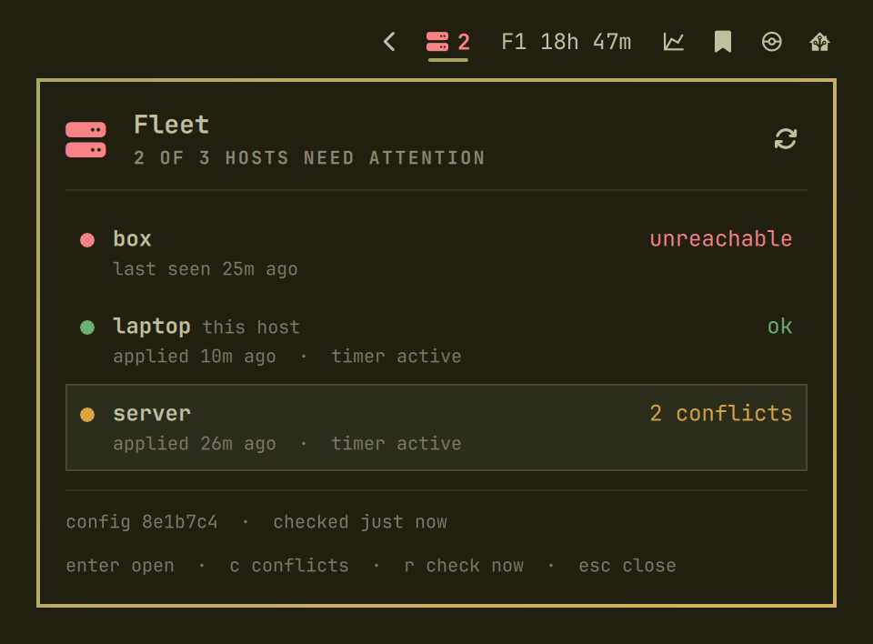

# Fleet for Omarchy

The health of your [fleet](https://github.com/RolfKoenders/fleet) in the [Omarchy](https://omarchy.dev) menu bar. One icon tells you when a host has a conflict, a stopped timer or can not be reached, so you notice without opening a terminal.



## What you get

- **One icon** that is green when every host is ok, amber for a conflict, an inactive timer or a host not seen for too long, red for a host that is unreachable or in error, and dim when there is no data yet. A number beside it counts the hosts that are not green.
- **A panel** with one row per host: its state, when it last applied, what its timer says and the first conflict, plus the config commit and when the fleet was last checked.
- **Shortcuts into the bridge**, fleet's full-screen view, from the panel.
- **It hides itself** when `fleet` is not on your path or has no host on this machine.

## Keyboard

With the panel open:

| Key | Does |
|---|---|
| `enter` | Open the bridge on Home, or on the selected host |
| `j` / `k` or the arrow keys | Select a host row |
| `c` | Open the bridge on Conflicts |
| `r` | Check the whole fleet now |
| `esc` | Close the panel |

With the mouse: click the header to open Home, click a host row to open that host, click the refresh button to check now.

Nothing in the bar pushes or runs doctor. Those stay in a terminal, behind `fleet`'s own prompts.

## How it checks

Every 15 minutes, and when you press `r`, it runs `fleet status --all --json`. That is the only fleet command it ever runs, it is read-only, and the plugin reads nothing but that JSON. The last result is kept in `~/.local/state/omarchy/io.github.rolfkoenders.fleet.json`, so after a restart the panel shows it, with its age, until the next check. The plugin writes nothing of fleet's.

A host is:

| State | When |
|---|---|
| red | its last check was unreachable or an error |
| amber | it has conflicts, its timer is not active, or it has not answered for longer than the not-seen threshold (2 hours) |
| green | none of the above |

A host's row says how many conflicts it has and, from fleet 2.2.0 on, names the first one as its kind and path, such as `link ~/.claude/CLAUDE.md`. A host on an older fleet does not send the list, so its row shows the count alone. The detail and the fix stay with `fleet status --conflicts` and the bridge's Conflicts screen.

A host with no `ssh` destination, which fleet can not ask and which applies on its own schedule, is shown as "not queried" and counts for nothing. The icon takes the worst host.

The plugin keeps only the fields it shows. Tool versions and clone details are dropped as the JSON is read, and text is cut and stripped of control characters, because a host can be wrong. It never reads secrets, and nothing it keeps or shows can hold one.

## One bridge at a time

Every action runs `omarchy-launch-or-focus-tui fleet bridge ...`. That launcher names the window after the command it starts, `fleet`, and not after its arguments, and focuses a window with that name if one exists. So every bridge shares one window class: if a bridge is open, any action focuses it, and a second one is never started. The cost is that a host row or `c` does not move an open bridge to that host or screen. Press `2` to `7` or select the host inside it.

## Settings

Set them in the Omarchy settings for the widget, or with `omarchy bar set io.github.rolfkoenders.fleet <key> <value>`.

| Key | Default | |
|---|---|---|
| `checkIntervalMinutes` | `15` | How often to run `fleet status --all` |
| `notSeenHours` | `2` | A host that has not answered for this long turns amber |
| `terminalCommand` | `omarchy-launch-or-focus-tui` | What opens `fleet bridge` in a terminal |
| `fleetCommand` | `fleet` | The fleet to run, for a checkout that is not on your path |
| `iconAlwaysUnlit` | `false` | Keep the icon in the bar's colour whatever the state. The count and the panel still show it |

The two command settings take plain words and paths only (letters, digits and `. _ / + @ : = -`). Anything else falls back to the default, because the launcher runs its arguments through a shell.

## Install

```bash
omarchy plugin add https://github.com/RolfKoenders/fleet-omarchy.git --enable
```

Or for local development:

```bash
git clone https://github.com/RolfKoenders/fleet-omarchy.git
cd fleet-omarchy
ln -sfn "$PWD" ~/.config/omarchy/plugins/io.github.rolfkoenders.fleet
omarchy restart shell
omarchy plugin enable io.github.rolfkoenders.fleet
```

The icon defaults to the right side of the bar. To move it:

```bash
omarchy bar move io.github.rolfkoenders.fleet --section right
```

## Remove

```bash
omarchy plugin remove io.github.rolfkoenders.fleet
```

The saved result stays in `~/.local/state/omarchy/`; delete `io.github.rolfkoenders.fleet.json` there if you want it gone.

## Requirements

- [Omarchy](https://omarchy.dev) with the shell plugin system
- [fleet](https://github.com/RolfKoenders/fleet), set up on this machine. Opening the bridge on a host or on Conflicts needs a fleet with `fleet bridge --view` and `--host`.

## Development

```bash
node tests/test_model.js        # states, parsing, settings, commands, from fixtures
python3 tests/test_qml_style.py # the QML house style
omarchy plugin validate .
```

`Model.js` holds every decision as plain functions and is tested under Node. `Service.qml` schedules the check and saves the result, `Panel.qml` and `HostRow.qml` draw.

To see the plugin on made-up hosts, point `fleetCommand` at `tests/fixture-fleet`. It answers `status --all --json` with a file from `tests/fixtures/` (the name in `tests/fixtures/.current`, `mixed` by default) and refuses everything else.

## License

MIT, see [LICENSE](LICENSE).
